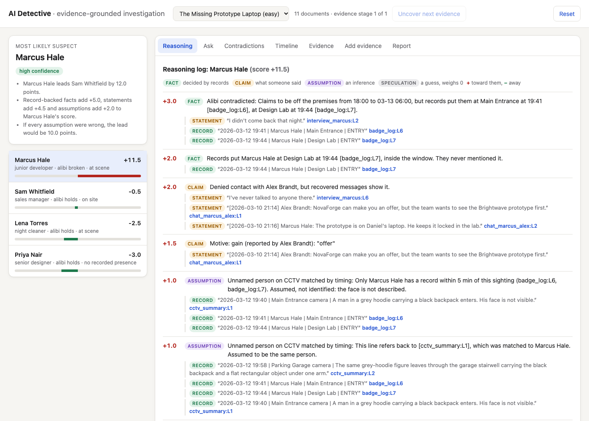

# AI Detective

An AI detective that solves fictional mysteries from a case file of witness interviews, chats,
emails, CCTV summaries and access logs. It is built to reason from evidence, not to guess:
every finding is tied to an exact quote from a source document, and anything that cannot be
found in the evidence is rejected.

- **Technical write-up:** [docs/DESIGN.md](docs/DESIGN.md) covers the architecture, reasoning,
  anti-hallucination layers, evaluation and limits.
- **Sample output:** [samples/](samples/) has the case reports, question and chat transcripts, the
  evaluation output and screenshots.



## Progress

| Milestone | Scope | Status | Tests |
|---|---|---|---|
| 1 | Evidence foundation: Case 1, extraction, search, timeline, grounding | Done (~20%) | 22 |
| 2 | Alibi checking, speculation flags, opportunity, holdout case | Done (~35%) | 28 |
| 3 | Disputed records, motives, links, investigator with a labelled reasoning log | Done (~60%) | 17 |
| 4 | Cases 2 and 3, explained confidence, checked case reports, evaluation script, reassessment as evidence arrives | Done (~80%) | 27 |
| 5 | Follow-up questions, adding evidence and reassessing, chat mode, web UI, more evaluation metrics, design write-up, samples | Done (100%) | 37 |

**Total: 131 automated tests, all passing.** Evaluation: culprit named correctly in 3/3 cases,
109/109 answer-key checks passed. Timeline accuracy, retrieval@5 and invented-evidence rejection
are all 100%.

## Quick start

```bash
python3 -m venv .venv && source .venv/bin/activate
pip install pytest
pytest -q                                   # 131 passed
python evaluate.py                          # score all three cases against their answer keys
python -m detective web                     # web UI at http://127.0.0.1:8000
python -m detective chat cases/case3_leaked_formula --stage 1    # interactive; try :uncover
python -m detective ask  cases/case1_missing_laptop "Did Marcus lie?"
```

---

## Milestone 1: the evidence foundation (~20%)

The system can read a case file, pull out who, where and when, search the evidence, and lay
everything out on a timeline, and it rejects anything that isn't in the documents.

### What was built

- **Case 1, "The Missing Prototype Laptop"** (easy): 11 documents (interviews, badge log,
  CCTV summary, a recovered chat, an email, a case brief, an irrelevant notice), 4 suspects and
  a known solution in `solution.json`. The case includes a lying suspect, a speculative
  accusation, a red-herring motive and an irrelevant document.
- **Structured extraction** of people, places and timed events. It handles aliases ("Marcus"
  means Marcus Hale), hedged times ("about 9:30 PM"), ranges ("from 7 PM to 8 PM") and relative
  days ("the next morning").
- **Searchable evidence store** (BM25) with person and document-type filters. Every search hit
  is a citable quote.
- **Timeline** that keeps hard **records** (badge log, CCTV, case brief) separate from witness
  **claims** (interviews, chats, emails). Records come first when both happen at the same minute.
- **Grounding (anti-hallucination).** Every event and mention carries a `Quote`: the document,
  the exact character span and the line number. Nothing leaves the pipeline unless its quote is
  found word for word in the source.
- **Optional Claude-assisted extraction.** Claude proposes extra events, and each proposal is
  accepted only if all four checks pass:
  1. its quote appears **verbatim** in the document;
  2. the time it gives is **actually stated** in that quote;
  3. its actor is a known person who is **named in the quote or is its speaker**;
  4. its location is a known place **named in the quote**.

  Rejected proposals are listed with the reason, so hallucinations are visible rather than silent.

### Try it

```bash
python -m detective timeline cases/case1_missing_laptop
python -m detective timeline cases/case1_missing_laptop --records
python -m detective timeline cases/case1_missing_laptop --person "Marcus Hale"
python -m detective search   cases/case1_missing_laptop "laptop drawer"
python -m detective entities cases/case1_missing_laptop

# Optional, needs the anthropic SDK and credentials:
pip install anthropic pydantic
export ANTHROPIC_API_KEY=...               # or: ant auth login
python -m detective timeline cases/case1_missing_laptop --llm
```

Example timeline rows:

```
2026-03-12 18:00        CLAIM   Marcus Hale @ Brightwave Office
                               "I left the office at 6 PM and went straight home."  [interview_marcus:L2]
2026-03-12 19:44        RECORD  Marcus Hale @ Design Lab
                               "2026-03-12 19:44 | Marcus Hale | Design Lab | ENTRY"  [badge_log:L7]
```

### Tests (22)

| File | What it checks |
|---|---|
| `test_loader.py` (3) | Case folder, front matter and answer key load correctly |
| `test_timeparse.py` (4) | Clock times, hedges, ranges, relative days |
| `test_entities.py` (3) | People and places found, aliases resolved to full names |
| `test_search.py` (2) | Relevant clues ranked first, person filter works |
| `test_timeline.py` (6) | Chronological order, records vs. claims, questions are not events, unidentified CCTV figure is not guessed |
| `test_grounding.py` (3) | Every quote is real; fabricated quotes are rejected |
| `test_llm_extract.py` (1) | Hallucinated LLM proposals are rejected with a reason (mocked, no API call) |

---

## Milestone 2: alibis, speculation and opportunity (~35%)

The system now checks what each person says about their whereabouts against the badge log and
CCTV, catches the lie, separates guesses from evidence, and shows who could have been at the
scene.

### What was built

- **Alibi checking.** Each first-person whereabouts claim is turned into a structured claim
  (departure, arrival, "didn't come back", present at a place, somewhere else). It is checked
  against a presence model built **only** from the badge log and CCTV. Every verdict quotes
  both the claim and the records behind it:
  - `SUPPORTED`: a record confirms it (Marcus's "left at 6 PM" vs. the 18:02 exit);
  - `CONSISTENT`: nothing conflicts, but the records can't confirm it (Priya's restaurant dinner);
  - `UNVERIFIED`: the records say nothing either way;
  - `CONTRADICTED`: a record rules it out (Marcus's "I didn't come back that night" vs. his
    19:41 entry and his 19:44 Design Lab badge).
- **Speculation flags.** Guesses ("it was probably Lena") and impressions ("Marcus has seemed
  stressed") are flagged with who said them and who they are about. They are never used as
  evidence.
- **Opportunity.** Each suspect is rated *at scene*, *on site* or *no recorded presence* for
  the crime window. Both ends of the window are quotes that must exist word for word in the
  evidence (an invented quote raises an error), and the times are read from those quotes.
- **Assumptions are stated.** Any conclusion that rests on missing records says so ("a missing
  record is not proof of absence").
- **Holdout case** (`tests/fixtures/holdout_violin`, "The Vanished Violin"): a second case with
  different people, places, wording and type of lie (a fake concert alibi rather than "didn't
  come back"). It matched its answer key on the first run, with no rule changes. It was written
  by the same author as the rules, so it is a check against overfitting, not proof of generality.

### Results on Case 1

| Suspect | Alibi | Opportunity |
|---|---|---|
| Marcus Hale | **Broken**: "didn't come back" vs. 19:41 entry and 19:44 Design Lab badge | At scene (19:44) |
| Priya Nair | Holds: left at 17:58; dinner consistent but unconfirmable | No recorded presence |
| Lena Torres | Holds: arrival, lab visit and exit all confirmed by badge log and CCTV | At scene (20:47) |
| Sam Whitfield | Holds: left at 18:40; video call from home consistent | On site until 18:40, never in the lab |

### Try it

```bash
python -m detective analyze     cases/case1_missing_laptop     # alibis + speculation + opportunity
python -m detective alibis      cases/case1_missing_laptop --person "Marcus Hale"
python -m detective speculation cases/case1_missing_laptop
python -m detective opportunity cases/case1_missing_laptop
python -m detective analyze     tests/fixtures/holdout_violin  # the holdout case
```

Example alibi check:

```
Marcus Hale (suspect): alibi BROKEN
  OK SUPPORTED    departure 18:00
       claim:  "I left the office at 6 PM and went straight home."  [interview_marcus:L2]
       record: "2026-03-12 18:02 | Marcus Hale | Main Entrance | EXIT"  [badge_log:L2]
  XX CONTRADICTED no_return 18:00-06:00
       claim:  "I didn't come back that night."  [interview_marcus:L2]
       record: "2026-03-12 19:41 | Marcus Hale | Main Entrance | ENTRY"  [badge_log:L6]
       record: "2026-03-12 19:44 | Marcus Hale | Design Lab | ENTRY"  [badge_log:L7]
```

### Tests (28)

| File | What it checks |
|---|---|
| `test_claims.py` (4) | Claims parsed with the right times and places; only the speaker's own first-person statements count |
| `test_alibi.py` (8) | Marcus's lie is caught with quotes from both sides; only the liar's alibi breaks; unconfirmable alibis stay "consistent"; a wrong time is caught |
| `test_speculation.py` (4) | Exactly the known guesses are flagged, and none is used as evidence |
| `test_opportunity.py` (6) | Window read from quoted evidence; access levels match the answer key; an invented window quote is rejected |
| `test_holdout.py` (5) | Same checks on the holdout case against its own answer key |
| `test_cli.py` (1) | `analyze` command reports the contradiction |

### Left for milestone 3 (now done)

- Lies that movement records can't test, such as Marcus's "I've never talked to anyone there"
  vs. his recovered chat with a NovaForge recruiter.
- Unidentified CCTV figures (the grey hoodie). Milestone 2 doesn't match them to anyone;
  milestone 3 does, labelled as an assumption.

---

## Milestone 3: motives, links and the investigator (~60%)

The system now weighs everything it has found. For each suspect it builds one reasoning log
in which every step is labelled, weighted and backed by exact quotes, then names the most likely
suspect with a confidence level.

### What was built

- **Disputed records** (`records.py`). A badge or login proves the card was used, not who used
  it. If CCTV shows the same person somewhere else within 5 minutes of a badge swipe, the swipe
  is marked as disputed and left out of the alibi and opportunity checks.
- **Motives** (`motive.py`). Statements that give someone a reason to act: **gain** (an offer
  or reward for the item), **intent** (a stated plan to take it), **money** trouble, **conflict**
  (an argument or refusal) and **need** (the person says they want the item). Each motive records
  who it belongs to and whether they said it themselves or someone else reported it. Guesses
  ("seemed stressed about money") are never treated as motives.
- **Links** (`links.py`).
  - *CCTV matches:* an unnamed person on camera is matched to someone only if exactly one person
    has a record within 5 minutes. A match is always labelled an **assumption**. A later line
    that refers back ("the same grey-hoodie figure") inherits the match.
  - *Hidden connections:* a suspect and an outside party who appear in the same chat or email
    are connected. If the suspect denied contact in an interview, the denial is shown next to
    the messages that contradict it.
- **Investigator** (`investigator.py`). One reasoning log per suspect. Every step has:
  - a **label**:
    - `FACT`: decided by records (badge log, login log, CCTV, brief);
    - `CLAIM`: rests on what someone said or wrote;
    - `ASSUMPTION`: an inference, such as a CCTV match or "no record means absent";
    - `SPECULATION`: a guess, which always weighs 0;
  - a **weight**, where positive points toward the suspect and negative away;
  - **exact quotes** from the documents.

  Scores are the sum of the weights. All weights are in one table (`WEIGHTS`) so the scoring
  policy is easy to review. A confidence level (high / medium / low) comes from the lead over the
  runner-up and from whether a record-backed fact points to the top suspect.
- **Optional LLM investigator.** Claude proposes extra steps, which pass through the same
  `validate` rules as the rules engine: quotes must be found word for word, a `FACT` may only
  cite records, `SPECULATION` must weigh 0 and weights stay within ±3. Anything else is rejected
  with the reason.

### Results on Case 1

| Suspect | Score | Main reasons |
|---|---|---|
| **Marcus Hale** | **+11.5** | Alibi contradicted by badge log (+3); at the scene and never said so (+2); job offer conditional on the prototype (+1.5); grey-hoodie CCTV figure matched by timing (+1, +1, assumptions); chat with NovaForge recruiter (+1) that he denied (+2) |
| Sam Whitfield | −0.5 | Alibi confirmed (−1) and consistent (−0.5); asked to borrow the laptop and was refused (+0.5 need, +0.5 conflict) |
| Lena Torres | −2.5 | Arrival, lab visit and exit all confirmed (−3); at the scene but said so and records agree (+0.5) |
| Priya Nair | −3.0 | Left before the window (−1); dinner consistent (−0.5); no recorded presence (−1.5, assumption) |

Most likely: **Marcus Hale**, confidence **high** (12-point lead, backed by record facts).
On the holdout case Tomas Reyes scores +12.5 and the other three are negative.

Sam does get a motive: he asked to borrow the laptop and was refused. That is real evidence
(the answer key lists it as a red-herring motive), so the system reports it rather than hiding
it, and the alibi and opportunity evidence outweigh it.

### Try it

```bash
python -m detective investigate cases/case1_missing_laptop                       # full reasoning log + conclusion
python -m detective investigate cases/case1_missing_laptop --person "Marcus Hale"
python -m detective motives     cases/case1_missing_laptop
python -m detective links       cases/case1_missing_laptop                       # CCTV matches, connections, disputes
python -m detective links       tests/fixtures/disputed_badge                    # a badge disputed by CCTV
python -m detective investigate cases/case1_missing_laptop --llm                 # add Claude's steps (needs credentials)
```

Example reasoning steps:

```
Marcus Hale: score +11.5
  +3.0  FACT        alibi: Alibi contradicted: Claims to be off the premises from 18:00 to 03-13 06:00, but records put them at Main Entrance at 19:41 [badge_log:L6], at Design Lab at 19:44 [badge_log:L7].
          tested: "I didn't come back that night."  [interview_marcus:L2]
          cites:  "2026-03-12 19:41 | Marcus Hale | Main Entrance | ENTRY"  [badge_log:L6]
  +1.0  ASSUMPTION  link: Unnamed person on CCTV matched by timing: Only Marcus Hale has a record within 5 min of this sighting (badge_log:L6, badge_log:L7). Assumed, not identified: the face is not described.
  +0.0  SPECULATION speculation: Priya Nair impression: "seemed". Not evidence; weighs nothing.

== CONCLUSION ==
  ranking: Marcus Hale +11.5, Sam Whitfield -0.5, Lena Torres -2.5, Priya Nair -3.0
  most likely: Marcus Hale  (confidence: high; Marcus Hale leads by 12.0 points; at least one record-backed fact points to them.)
```

### Tests (17)

| File | What it checks |
|---|---|
| `test_records.py` (2) | Case 1 has no disputed records; a badge disputed by CCTV is left out of alibi and opportunity |
| `test_motive.py` (4) | Motive types match both answer keys; the culprit's motive is cited and reported by someone else; guesses are never motives; the culprit has the strongest motive |
| `test_links.py` (3) | CCTV matches are labelled assumptions and match both answer keys; they cite the records they rely on; hidden connections and denials are found |
| `test_investigator.py` (7) | Every step is labelled, cited and grounded; facts cite only records; speculation never changes a score; the evidence favours the culprit in both cases (lead of 5+ points, everyone else negative); a fact citing a statement is rejected; LLM steps follow the same rules |
| `test_cli.py` (+1) | `investigate`, `motives` and `links` commands |

New fixtures: `tests/fixtures/disputed_badge` (Nora's badge opens the Server Room while CCTV
shows her in the canteen), plus a recovered chat with a buyer and a denial added to the holdout.

### Not yet covered

- The weights are a hand-set policy, not learned. They are tested on two cases, both written by
  the same author as the rules, so Cases 2 and 3 will be the real test.
- The LLM investigator is only tested offline with a fake. It has not been run against Claude
  in this repo's tests.

---

## Milestone 4: three cases, reports and evaluation (~80%)

The system now handles all three required cases, writes a full case report whose citations are
all checked against the source text, and an evaluation script scores every case against its
answer key.

### What was built

- **Case 2, "The Gallery Switch"** (twisted): overnight, a painting is replaced with a forgery.
  - The culprit has a **"perfect" alibi from a friend**: "Victor was with me at my flat from 8 PM
    until midnight." The system records this as a statement Celia made about Victor (`vouch`),
    never as a record. The gallery's guest Wi-Fi log shows Victor's phone at the Side Door at 21:04,
    so his alibi and Celia's both fall.
  - **The guard's badge was used by someone else.** It opened the Vault Room at 21:10, but CCTV
    shows the guard at the front desk at 21:13, so the swipe is disputed and left out.
  - **Contradictory statements:** the cleaner saw Victor at the side door around 21:05, which
    conflicts with Celia's account. The records back the cleaner.
  - **Misleading clues:** the guard's badge, a curator's guess ("it was probably Omar") and the
    guard's money complaints all point at the wrong person and are outweighed.
- **Case 3, "The Leaked Formula"** (impossible): a secret formula is downloaded and leaked.
  - The evidence arrives in **two stages**. With the first 8 documents, Iris's account is logged
    in at the terminal, she had a grudge and a colleague blames her, so the system names **Iris**.
  - At stage 2, CCTV shows Iris in the car park four minutes after "her" login, which disputes
    the login. CCTV also shows someone at the terminal at 22:12, matched by timing to Noah's badge.
    A recovered chat shows a competitor offering Noah money, which he denied. The system switches
    to **Noah**.
  - Noah's own account of the evening is true, so his alibi holds. He is caught by the denial,
    the motive and the CCTV match, which is why confidence is **medium**, not high.
- **Explained confidence.** Each conclusion states the lead over the runner-up, how much comes
  from record-backed facts, statements and assumptions, and how big the lead would be if every
  assumption were wrong.
- **Case report** (`report.py`). A Markdown report with these sections:
  - conclusion and confidence;
  - ranking;
  - the case against the top suspect;
  - why not the others;
  - contradictions;
  - misleading evidence set aside;
  - records in the crime window;
  - for staged cases, how the conclusion changed.

  Before the report is returned, a checker parses the finished text and verifies **every
  citation**: each quote must appear on the cited line of the cited document, and each line
  reference must exist. A report with a bad citation is refused.
- **Evaluation** (`evaluate.py`). Runs every case and turns each item in its answer key into a
  pass/fail check: the culprit, the early wrong lead, each lie caught, honest alibis intact, red
  herrings below the culprit, disputed records, statement conflicts, speculation, motives, CCTV
  matches, connections, opportunity, and report citations.
- **Engine changes the new cases needed:**
  - statements about other people (a friend vouching, a witness sighting);
  - conflicts between two witnesses' statements;
  - evidence stages (`stage:` in a document's front matter, `--stage` on the command line);
  - "midnight" as a time;
  - door-aware disputes (badging out and then appearing on the car park camera is one trip, not
    a conflict);
  - a Wi-Fi or login record at a door counting as being on site.

### Results

```
| Case                         | Difficulty | Named       | Expected    | Confidence | Checks passed | Score |
| The Missing Prototype Laptop | easy       | Marcus Hale | Marcus Hale | high       | 21/21         | 100%  |
| The Gallery Switch           | twisted    | Victor Lane | Victor Lane | high       | 23/23         | 100%  |
| The Leaked Formula           | impossible | Noah Fisk   | Noah Fisk   | medium     | 22/22         | 100%  |

Culprit named correctly in 3/3 cases; 66/66 checks passed (100%).
```

Case 3 at stage 1 names Iris Kemp (+1.5), which is the intended wrong lead. With all evidence,
Noah Fisk scores +4.0 and Iris −0.5.

### Try it

```bash
python evaluate.py -v                                              # every check, every case
python -m detective report      cases/case2_gallery_switch --out case2_report.md
python -m detective report      cases/case3_leaked_formula        # includes "how the conclusion changed"
python -m detective investigate cases/case3_leaked_formula --stage 1   # the early, wrong picture
python -m detective links       cases/case2_gallery_switch        # disputed guard badge, CCTV match
```

### Tests (27)

| File | What it checks |
|---|---|
| `test_case2.py` (7) | Culprit named with high confidence; the friend's alibi is a statement about Victor, contradicted by the Wi-Fi log; the guard's badge is disputed and excluded; the witness conflict is resolved by records; misleading clues against the guard are outweighed; the side-door figure is matched as an assumption |
| `test_case3.py` (6) | Stage 1 names the wrong person; full evidence names the culprit with medium confidence; the login is disputed only once CCTV arrives; a door exit followed by a car park sighting is not a dispute; stages load in order; a culprit with a true alibi is caught by the denial |
| `test_report.py` (7) | The report names the suspect and explains confidence; every citation in all three reports matches its source; a tampered quote and a missing line are caught; the Case 3 report shows how the conclusion changed |
| `test_evaluate.py` (4) | All three cases solved with every check passing; a wrong answer key is detected; the `evaluate` and `report` commands work |
| `test_statements.py` (2), `test_timeparse.py` (+1) | A person's own account is not a witness conflict; a door record without a direction counts as on site; midnight ends the day |

### Not yet covered

- **Follow-up questions** from an investigator ("why not Lena?", "what if the CCTV match is
  wrong?") are not supported yet.
- **The LLM has not been run live.** The LLM extractor and investigator are tested offline with
  fakes.
- **All three cases were written by the same author as the rules.** Each case needed some
  general engine changes (listed above), but no case-specific rules or weights. A case written
  by someone else would be a stronger test.

---

## Milestone 5: questions, reassessment, interfaces and write-up (100%)

The investigator can now ask follow-up questions, add or uncover evidence and see exactly what
changes, through the command line, an interactive chat or a web UI. The evaluation measures the
brief's criteria directly, and the design is written up in [docs/DESIGN.md](docs/DESIGN.md).

### What was built

- **Follow-up questions** (`qa.py`). Questions like these are answered from the structured
  findings, with every citation tagged as a record, statement, assumption or speculation:
  - "Did Sam lie?" lists his statements that records contradict or confirm;
  - "Where was Marcus at 19:45?" gives what the records show, any assumptions, then what people
    said, including disputed records that were set aside;
  - "Who was in the Design Lab at 20:50?";
  - motive, alibi, why / why not, who did it, how confident, contradictions, opportunity,
    connections, and what happened at a given time.

  Anything else falls back to an evidence search with no conclusion drawn. An unknown name
  ("Where was Ruth?") is said to be unknown, not guessed. With `--llm`, Claude phrases the answer;
  any quote it gives that isn't in the documents is dropped and listed.
- **Adding evidence and reassessing** (`reassess.py`). Uncovering a case's next stage, or adding a
  new document, re-runs the whole investigation from scratch and shows:
  - the before/after ranking and confidence;
  - for each suspect, the steps that stopped counting and the new ones;
  - new disputed records and new contradictions.
- **Interactive chat** (`chat`): questions plus `:uncover`, `:add FILE`, `:who` and
  `:report [FILE]`.
- **Web UI** (`web`). Standard library only, no external scripts. It shows:
  - the verdict and confidence explanation, and the suspect ranking;
  - each suspect's reasoning log;
  - a question box, contradictions and misleading evidence, and the timeline (disputed records
    struck through);
  - an evidence viewer where every citation opens the source line;
  - adding or uncovering evidence with a before/after banner, and the full report.

  The server keeps no state, accepts only known case folders and caps request size. There's a
  light and a dark theme.
- **Evaluation metrics for the brief's criteria** (`evaluate.py`):
  - **timeline accuracy:** each case's key events must be found with the right time, person, place
    and source;
  - **retrieval@5:** a search for each key fact must find its document in the top 5;
  - **grounding attack:** about 30 believable fakes per case (the real line with one detail
    changed, such as 19:41 → 19:44), plus facts citing statements and weighted speculation, go
    through the event extractor, the investigator and the answerer. All must be rejected, and all
    genuine counterparts accepted.
- **Live LLM run** (`llm-run`). It runs Claude's extraction, reasoning steps and answers on every
  case and records what was accepted and rejected, with reasons, in `samples/llm_runs/`. It stops
  cleanly without credentials.
- **Write-up and samples:**
  - [docs/DESIGN.md](docs/DESIGN.md);
  - [samples/reports/](samples/reports/): the three case reports, citations checked;
  - [samples/transcripts/](samples/transcripts/): question answers for each case, a chat session
    uncovering Case 3, and adding evidence to Case 1;
  - [samples/evaluation.md](samples/evaluation.md);
  - [samples/screenshots/](samples/screenshots/).

### Results

```
| Case                         | Named       | Confidence | Timeline | Retrieval@5 | Invented rejected | Checks |
| The Missing Prototype Laptop | Marcus Hale | high       | 100%     | 100%        | 100%              | 35/35  |
| The Gallery Switch           | Victor Lane | high       | 100%     | 100%        | 100%              | 37/37  |
| The Leaked Formula           | Noah Fisk   | medium     | 100%     | 100%        | 100%              | 37/37  |

Culprit named correctly in 3/3 cases; 109/109 checks passed (100%).
```

| Screenshot | Shows |
|---|---|
| [Case 1 reasoning](samples/screenshots/1_case1_reasoning.png) | Verdict, confidence explanation, ranking and Marcus's cited reasoning log |
| [Case 2 contradictions](samples/screenshots/2_case2_contradictions.png) | The friend's false alibi, the witness conflict and the disputed guard badge |
| [Case 2 questions](samples/screenshots/3_case2_ask.png) | "Is Celia telling the truth?" and "Where was Omar at 21:10?" |
| [Case 3 at stage 1](samples/screenshots/4_case3_stage1_wrong_lead.png) | The early, wrong lead (Iris) |
| [Case 3 after uncovering](samples/screenshots/5_case3_uncover_reassess.png) | "Conclusion changed: Iris Kemp → Noah Fisk" with every change explained |
| [Evidence viewer](samples/screenshots/6_evidence_viewer.png) | A citation opened at its source line |
| [Report](samples/screenshots/7_report.png) | The case report in the browser |
| [Dark mode](samples/screenshots/8_dark_mode.png) | Case 2 reasoning in the dark theme |

### Try it

```bash
python -m detective web                                            # then open http://127.0.0.1:8000
python -m detective ask cases/case2_gallery_switch "Is Celia telling the truth?"
python -m detective ask cases/case3_leaked_formula "Where was Iris at 22:15?"
python -m detective reassess cases/case3_leaked_formula --stage 1  # uncover stage 2 and compare
python -m detective reassess cases/case1_missing_laptop --add samples/new_evidence/case1_sam_returns.txt
python -m detective chat cases/case3_leaked_formula --stage 1      # :uncover, :add FILE, :report
python evaluate.py -v                                              # every check, every case
python -m detective llm-run                                        # live Claude run (needs ANTHROPIC_API_KEY)
```

### Tests (37)

| File | What it checks |
|---|---|
| `test_qa.py` (20) | Liars caught and honest people cleared (including a friend's false alibi); "where" answers separate records, statements and assumptions and mention disputed records; who was at a place; unknown names aren't invented; every answer to 10 sample questions is grounded; unrecognised questions fall back to search; LLM answers keep real quotes and drop invented ones |
| `test_reassess.py` (6) | Uncovering Case 3 changes the conclusion, with the reasons; added evidence is reassessed from scratch without changing the original case; duplicates are refused; stages uncover in order; the chat runs questions and commands |
| `test_web.py` (5) | Case overview, questions, reassessment, report and document endpoints; unknown cases and bad evidence are refused; the HTTP server works end to end |
| `test_metrics.py` (4) | Invented evidence is always rejected and genuine evidence accepted; the fakes are believable; timeline and retrieval metrics; a missing timeline event fails its check |
| `test_llm_run.py` (2) | The live-run recorder counts accepted and rejected items correctly and writes its JSON and summary |

### Still open

- **The live Claude run hasn't been done:** this machine had no API credentials. Set
  `ANTHROPIC_API_KEY` and run `python -m detective llm-run` to record it. The LLM code paths are
  verified offline with stand-in models and the grounding attack.
- **The three cases were written alongside the rules.** A case written by someone else would be
  the strongest test of how well the system generalises.

---

## Architecture

```
cases/<case>/case.json        cast list (suspects, outside parties), places (on/off site, entrances), scene, item, quoted window bounds
cases/<case>/documents/*.txt  evidence, each with front matter (id, type, date, author)
cases/<case>/solution.json    answer key: read only by tests, never by the pipeline
tests/fixtures/holdout_violin second case with its own answer key, used only by tests
tests/fixtures/disputed_badge small case where CCTV disputes a badge swipe
cases/<case>/documents/*.txt  `stage: 2` in front matter = evidence uncovered later (Case 3)
evaluate.py                   score all cases against their answer keys
docs/DESIGN.md                technical write-up
samples/                      reports, transcripts, evaluation output, screenshots, new-evidence example

detective/
  # Milestone 1
  loader.py            parse case folder + front matter
  segments.py          split documents into citable sentences / log lines, track speakers
  grounding.py         Quote creation + verification (the anti-hallucination layer)
  timeparse.py         clock times, hedges, ranges, relative days
  entities.py          roster/alias matching for people and places
  events.py            rule-based timed-event extraction
  llm_extract.py       LLM proposals -> validated Events or Rejections
  anthropic_backend.py Claude calls with structured output: event extraction, investigator steps (lazy import)
  store.py             BM25 evidence search
  timeline.py          ordering, record/claim split, per-person views, rendering
  # Milestone 2
  claims.py            first-person whereabouts claims (departure, arrival, no-return, present, elsewhere)
  presence.py          who was on site when, from badge log + CCTV only
  alibi.py             claim vs. records -> supported / consistent / unverified / contradicted
  speculation.py       guesses and impressions, flagged and kept out of the evidence
  opportunity.py       evidence-anchored crime window + at-scene / on-site / none per suspect
  # Milestone 3
  records.py           badge/login records disputed by CCTV, kept out of presence
  motive.py            gain / intent / money / conflict / need, with owner and who reported it
  links.py             CCTV matches by timing (assumptions), hidden connections + denials
  investigator.py      labelled, weighted, cited reasoning log; scores; confidence; LLM step validation
  # Milestone 4
  statements.py        conflicts between witness statements, resolved by records where possible
  report.py            Markdown case report + citation checker that verifies the finished text
  evaluate.py          answer-key checks per case, summary table
  # Milestone 5
  qa.py                follow-up questions answered from the findings, citations tagged by kind
  reassess.py          re-run on new or uncovered evidence and compare before/after
  chat.py              interactive session (:uncover, :add, :who, :report)
  web.py               local web UI + JSON API (standard library); page in web_static/index.html
  llm_run.py           live Claude run on every case, recording accepted and rejected items
  # Shared
  pipeline.py          wires it together; final check that every quote it outputs is grounded
  cli.py               command-line explorer
```

## Design choices

- **Records vs. claims** is decided by document type, not by the LLM, so a confident witness
  can never be promoted to a fact.
- **Rules first, LLM second.** Rule-based extraction gives a deterministic, testable baseline;
  the LLM adds coverage on messy prose, behind the same grounding checks.
- **Claims are checked against records, never the reverse.** The presence model is built from
  movement logs only, so a witness can't place themselves (or anyone else) at the scene.
- **Two levels of "fine".** `SUPPORTED` needs a confirming record; `CONSISTENT` only means
  nothing conflicts. An alibi nobody can check is never reported as confirmed.
- **A badge is not a person.** Card and login records can be disputed by CCTV; a camera can't
  be disputed by a card.
- **A friend's word is not a record.** An alibi given by someone else is kept as that person's
  statement; it can be contradicted by records, but it can never confirm an alibi on its own.
- **Check the output, not just the inputs.** The report checker parses the finished Markdown,
  so a bug in the report code can't produce a citation that doesn't exist.
- **One set of rules for rules and LLM.** Every reasoning step, whoever wrote it, goes through
  the same `validate` check before it can change a score.
- **Speculation is shown, never counted.** Guesses appear in the log so the investigator can
  see them, with weight 0.
- **The model never sees the answer key.** `solution.json` is used only for evaluation.
